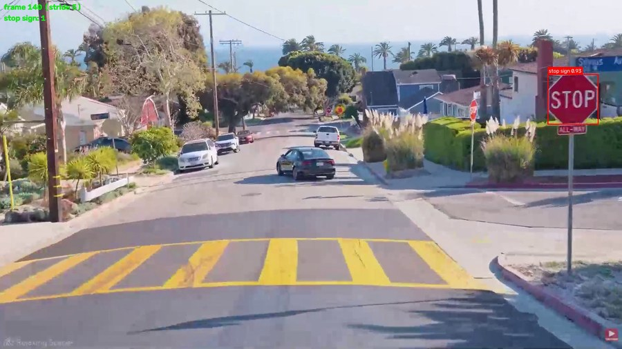
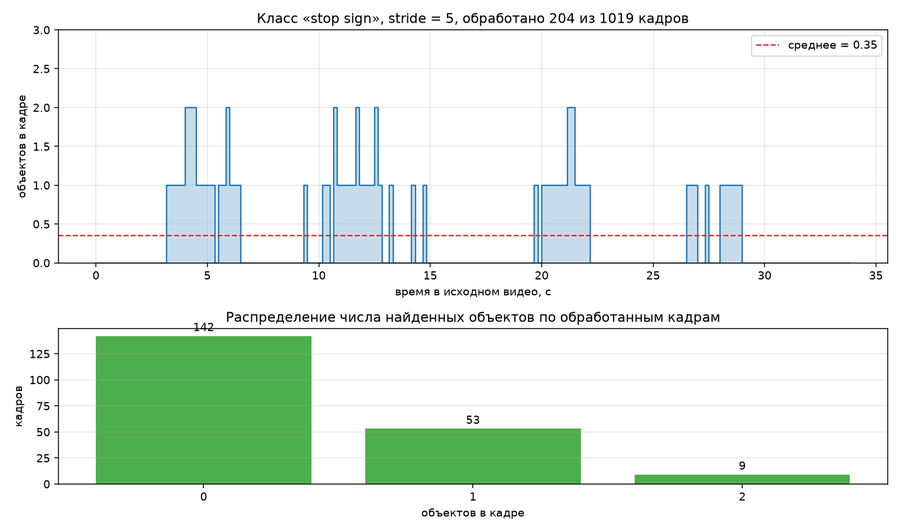
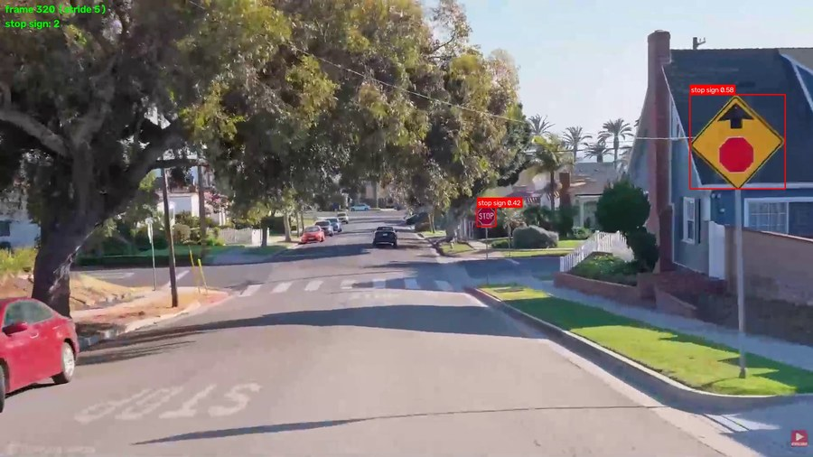

# Лабораторная работа №4. Подсчёт объектов в видео

**Вариант 7: класс `stop sign` (знаки STOP), stride = 5.**

Конвейер: *видео → отбор каждого N-го кадра → детекция YOLO → подсчёт → `report.json`*.
Всё запускается одной командой, работает на CPU, без GPU и без интернета после
первого скачивания весов.



---

## 1. Быстрый старт в VS Code

1. **Открыть папку проекта:** `File → Open Folder…` → папка `sii-lr04-stop-sign`.
2. **Создать окружение и поставить зависимости** (один раз, ~5 минут — качается PyTorch):
   ```powershell
   python -m venv .venv
   .\.venv\Scripts\python.exe -m pip install --upgrade pip
   .\.venv\Scripts\python.exe -m pip install -r requirements.txt
   ```
   В VS Code интерпретатор уже прописан в [.vscode/settings.json](.vscode/settings.json)
   (`.venv\Scripts\python.exe`), поэтому после установки сразу виден в правом нижнем углу.
3. **Запустить подсчёт:** `F5` → конфигурация **«ЛР4: stop sign, stride 5»**
   (или `Terminal → Run Task…` → «1. Подсчёт: stop sign, stride 5»).
4. **Посмотреть результат:** `out/report.json`, `out/annotated.mp4`, `out/frames/*.jpg`.
5. **Построить график:** `Terminal → Run Task…` → «3. График по кадрам».

Те же шаги без VS Code — обычным терминалом в папке проекта:

```powershell
.\.venv\Scripts\python.exe -m src.count_video --source data/sample_stop_signs.mp4 --class "stop sign" --stride 5
```

---

## 2. CLI

```text
python -m src.count_video --source <видео> --class <класс COCO> --stride <N>
```

| Параметр | По умолчанию | Что делает |
|---|---|---|
| `--source` | — (обязателен) | путь к видео |
| `--class` | — (обязателен) | имя класса COCO: `"stop sign"`, `"person"`, `"car"`… |
| `--stride` | `5` | обрабатывать каждый N-й кадр |
| `--model` | `yolo11n.pt` | веса YOLO (при первом запуске скачиваются автоматически) |
| `--conf` | `0.25` | порог уверенности детекции |
| `--iou` | `0.45` | порог NMS |
| `--imgsz` | `960` | сторона входа модели; 960 выбрано ради мелких знаков |
| `--device` | авто | `cpu`, `cuda:0`, `mps` |
| `--out` | `out` | каталог для артефактов |
| `--limit` | `0` | обработать только первые N кадров (быстрый тест) |
| `--save-video / --no-save-video` | вкл. | писать ли `out/annotated.mp4` |
| `--video-fps` | `source` | fps видео с рамками: `source` — как в исходнике (каждый обработанный кадр повторяется stride раз), `stride` — fps/stride |
| `--max-frame-saves` | `30` | сколько кадров с детекциями сохранить в `out/frames/` |

Дополнительные скрипты:

```powershell
# сравнение stride 5 / 10 / 20 (для обоснования выбора stride)
.\.venv\Scripts\python.exe -m scripts.compare_stride --source data/sample_stop_signs.mp4 --class "stop sign" --strides 5 10 20

# график «объектов в кадре по времени»
.\.venv\Scripts\python.exe -m scripts.plot_timeline
```

---

## 3. Результаты прогона (вариант 7)

Команда:

```powershell
python -m src.count_video --source data/sample_stop_signs.mp4 --class "stop sign" --stride 5
```

Лог (сокращён):

```text
Видео: 1920x1080, 30.00 fps, ~1019 кадров, ~34.0 c
Класс 'stop sign' -> id 11
Видео с рамками: 30.00 fps, повтор каждого кадра x5
обработано кадров: 101, пропущено: 400, найдено объектов: 45
обработано кадров: 202, пропущено: 804, найдено объектов: 71
Готово: кадров всего 1019, обработано 204, пропущено 815, за 80.2 c (2.54 кадра/с)
```

`out/report.json` (полностью):

```json
{
  "source": "data/sample_stop_signs.mp4",
  "class_name": "stop sign",
  "stride": 5,
  "frames_total": 1019,
  "frames_processed": 204,
  "detections_per_frame_mean": 0.348,
  "detections_per_frame_max": 2,
  "unique_tracks": null,
  "model_version": "yolo11n.pt (ultralytics 8.4.212)",
  "elapsed_sec": 80.21,
  "report_version": "v1.0",
  "detections_total": 71,
  "frames_with_detections": 62,
  "frames_skipped": 815,
  "processed_fps": 2.54,
  "video_fps": 30.0,
  "video_duration_sec": 33.97,
  "conf_threshold": 0.25,
  "iou_threshold": 0.45,
  "imgsz": 960,
  "annotated_video_fps": 30.0,
  "annotated_frame_repeat": 5,
  "tracker": "none",
  "notes": "Трекер не используется, поэтому unique_tracks = null: счётчик считает детекции на каждом обработанном кадре, а не уникальные объекты…"
}
```

Итоговые агрегаты:

| Показатель | Значение |
|---|---:|
| Кадров в видео | 1019 |
| Обработано кадров (stride 5) | 204 |
| Пропущено кадров | 815 |
| Среднее число знаков на обработанный кадр | **0.348** |
| Максимум знаков в кадре | **2** |
| Всего детекций | 71 |
| Кадров хотя бы с одной детекцией | 62 из 204 (30 %) |
| Время работы | 80.2 с (2.54 обработанных кадра/с, CPU) |



На графике видно, что знаки STOP встречаются «пачками»: подъезд к перекрёстку —
несколько секунд с детекциями (иногда 2 знака сразу: свой и навстречу), затем
десятки секунд пустой дороги. Поэтому среднее 0.35 — это не «на дороге почти нет
знаков», а «на 70 % обработанных кадров их нет вовсе».

> `out/annotated.mp4`, лежащий в репозитории, дополнительно пережат в H.264
> (`-crf 26`): OpenCV на Windows пишет mp4v (52 МБ на этот клип), потому что
> кодека `avc1` без `openh264.dll` нет. При своём прогоне CLI перезапишет файл
> в mp4v; чтобы снова получить компактный вариант:
>
> ```powershell
> ffmpeg -i out/annotated.mp4 -c:v libx264 -crf 26 -pix_fmt yuv420p out/annotated_h264.mp4
> Move-Item -Force out/annotated_h264.mp4 out/annotated.mp4
> ```

---

## 4. Почему stride = 5

**Что даёт stride.** Обработка кадра YOLO на CPU стоит ~0.25 с (imgsz 960, 1080p),
плюс запись видео с рамками ~0.12 с на обработанный кадр. Время работы почти
линейно падает с ростом stride: 204 кадра → 55.9 с, 102 кадра → 35 с, 51 кадр → 24 с.
В основном прогоне §3 получилось 80.2 с — там дополнительно писался
`annotated.mp4` (1020 кадров 1080p), а в эксперименте ниже видео не писалось.

**Что теряется.** Между обработанными кадрами объект может появиться и исчезнуть.
В нашем видео машина едет по жилой улице ~25 mph (~11 м/с), при 30 fps это ~0.37 м
за кадр; между кадрами при stride 5 — ~1.9 м (0.17 с). Знак STOP остаётся в кадре
2–4 с, то есть при stride 5 попадает примерно в 12–24 обработанных кадра — запас
огромный. Даже stride 20 (1.5 Гц, ~0.67 с между кадрами) формально «успевает»
увидеть знак, но:

* мелкие знаки на дистанции видны в 1–2 кадра, и с ростом stride вероятность
  поймать именно такой кадр падает;
* подсчёт становится «рваным»: у знака остаётся 3–4 точки вместо 12–24, и по такому
  ряду уже нельзя оценить, сколько времени объект был в кадре.

**Измерение на этом же видео** (`scripts.compare_stride`, одинаковые модель и порог,
видео с рамками не пишется):

| stride | обработано кадров | среднее | максимум | детекций всего | кадров с детекциями | время, с | кадр/с |
|---:|---:|---:|---:|---:|---:|---:|---:|
| **1** (эталон) | 1019 (100 %) | 0.37 | 3 | 376 | 310 | 227.9 | 4.47 |
| **5** | 204 (20 %) | 0.35 | 2 | 71 | 62 | 55.9 | 3.65 |
| 10 | 102 (10 %) | 0.36 | 2 | 37 | 32 | 35.0 | 2.91 |
| 20 | 51 (5 %) | 0.41 | 2 | 21 | 18 | 23.9 | 2.13 |

Выводы, которые важны для отчёта:

1. Стоимость падает почти линейно: 228 → 56 → 35 → 24 с, то есть stride 20
   в 9.5 раза быстрее эталонного прогона.
2. Число найденных детекций падает **пропорционально**: stride 5 просмотрел 20 %
   кадров и нашёл 71 из 376 детекций (18.9 %). Среднее на кадр при этом почти не
   изменилось (0.35 против 0.37, разница 5 % — в пределах разброса), значит stride 5
   оценивает плотность знаков практически без смещения. Плата — в 5 раз меньше
   «точек», но каждая потерянная точка при stride 1 это тот же знак в соседних
   кадрах, а не другой знак.
3. На stride 10 и 20 среднее начинает **расти** (0.36 и 0.41, до +11 % к эталону) —
   это уже смещение малой выборки, а не улучшение. Значит, сравнивать разные
   stride по среднему нельзя: только по абсолютному числу детекций.
4. Видно и «выпадение» событий: при stride 1 максимум в кадре = 3 знака, при
   stride 5 — только 2. То есть кадр, где одновременно видны три знака, stride 5
   пропустил. Для отчёта «сколько всего знаков» это неважно, для «сколько знаков
   на конкретном перекрёстке» — уже важно.
5. Поэтому выбран **stride 5**: он сохраняет оценку плотности (0.35 против 0.37),
   даёт 4-кратную экономию и укладывается в минуту CPU-времени на 34-секундный
   клип. Для «посмотреть, что знаки есть и где их много» этого достаточно, а для
   честного подсчёта уникальных знаков всё равно нужен трекер (см. §5), и тогда
   stride придётся уменьшать до 1–2.

**Честная оценка потерь.** Эталон — строка stride 1: 376 детекций за 228 с.
Stride 5 сохраняет 71 из них (19 %) и теряет кадр с тремя знаками сразу; знаки,
которые видны меньше 5 кадров (дальние, частично перекрытые), могут не попасть
в выборку вообще. Это принятая плата за скорость — она измерена и указана явно,
а не замаскирована.

---

## 5. Трекер: почему `unique_tracks: null`

Трекер в работе **не используется** — это разрешено заданием, но ограничение нужно
назвать явно.

Что считает наш конвейер: **детекции на обработанных кадрах**, а не объекты.

* Один и тот же знак STOP, пока он в кадре, попадает в 12–24 обработанных кадра →
  в `detections_total` он учитывается 12–24 раза. Поэтому `detections_total = 71`
  **не означает** «71 знак STOP в клипе».
* Между обработанными кадрами знак может появиться и исчезнуть — такая детекция
  не учитывается вообще.
* Без ID объекта нельзя отличить «новый знак» от «тот же знак, снятый с другого
  ракурса», поэтому число уникальных знаков не вычисляется → `unique_tracks = null`.

Как это исправить (не требуется в ЛР, но очевидный следующий шаг): Ultralytics
`model.track(..., persist=True, tracker="bytetrack.yaml")`, затем считать число
уникальных `track_id` для целевого класса. Тогда «уникальные знаки» станут
осмысленной величиной, а stride нужно будет уменьшить, иначе трекер будет терять
объект между кадрами и присваивать новые ID.

---

## 6. Ограничения решения

1. **Мелкие объекты.** Знаки STOP на дистанции занимают 15–25 px по стороне. При
   `imgsz=960` и `conf=0.25` часть таких детекций теряется — проверено на 10 кадрах:
   на кадрах 35, 300 и 420 `yolo11n` не нашёл ничего, а `yolo11s` нашёл знак с
   уверенностью 0.28, 0.77 и 0.78. Модель крупнее — лучше recall, но линейно дороже:
   `yolo11s` при `imgsz=960` ≈ 1.0–1.5 с/кадр на CPU против ~0.25 с у `yolo11n`.
2. **Похожие объекты.** Жёлтый ромб «STOP AHEAD» детектор считает `stop sign`:
   на кадре 320 он дал уверенность 0.58 (и попал в подсчёт как второй «знак»),
   на кадре 35 — только 0.17 (отсечён порогом). Формально это не знак STOP, а
   предупреждающий ромб, — типичная ошибка класса, которую нужно упоминать в
   выводах (см. картинку ниже).
3. **Порог уверенности.** `conf=0.25` — компромисс; снижение до 0.15 добавляет
   находок, но и ложных срабатываний. Порог записан в `report.json`, поэтому
   результаты воспроизводимы.
4. **Декодирование не экономится.** Кадры всё равно читаются последовательно
   (`cap.read()`), stride экономит только инференс. Для больших stride можно
   прыгать по `CAP_PROP_POS_FRAMES`, но на части кодеков это работает неточно.
5. **Один поток, CPU.** 2.5 обработанных кадра/с (вместе с записью видео). На GPU
   (CUDA) то же видео обрабатывалось бы в десятки раз быстрее, и stride можно было
   бы ставить 1–2.
6. **Нет стабилизации счёта.** Рамка может «мигать» на границе порога; сглаживание
   по времени (медиана за k кадров) не реализовано.
7. **Запись видео недешёвая.** `annotated.mp4` пишется через OpenCV (mp4v) и на
   1080p добавляет ~25 с к 34-секундному клипу — в эксперименте §4 видео не
   писалось, поэтому там время меньше.

Пример ошибки класса (жёлтый «STOP AHEAD» посчитан как `stop sign`, уверенность 0.58):



---

## 7. Структура проекта

```text
sii-lr04-stop-sign/
├── data/
│   ├── sample_stop_signs.mp4    # учебный фрагмент 34 с, 1080p (см. data/SOURCE.md)
│   └── SOURCE.md                # источник и лицензия видео
├── src/
│   └── count_video.py           # CLI: видео → кадры → YOLO → подсчёт → report.json
├── scripts/
│   ├── compare_stride.py        # прогон с разными stride + сводная таблица
│   └── plot_timeline.py         # график «объектов в кадре по времени»
├── out/                         # результаты (пересоздаются одной командой)
│   ├── report.json              # главный артефакт ЛР
│   ├── annotated.mp4            # видео с рамками (30 fps, каждый кадр x5)
│   ├── frames/                  # 30 кадров с детекциями (jpg, 1080p)
│   ├── timeline.csv             # номер кадра → число объектов
│   ├── timeline_plot.png        # график по кадрам
│   └── stride_exp/              # сравнение stride 1/5/10/20
├── docs/
│   ├── REPORT.md                # краткий отчёт по работе
│   └── img/                     # картинки для README
├── .vscode/                     # launch.json / tasks.json / settings.json
├── requirements.txt
└── README.md
```

---

## 8. Источник и лицензия видео

* **Оригинал:** YouTube, канал **Relaxing Scenes / Relaxing Scenes Driving** —
  «Driving California 8K Dolby Vision HDR – Palos Verdes to Dana Point»
  (1920×1080, 30 fps, 91.97 с, 2759 кадров).
* **Что в репозитории:** фрагмент **00:58 – 01:32** исходного ролика, 1920×1080
  (разрешение и 30 fps как в оригинале), 33.97 с, 1019 кадров, H.264, без звука
  (24.6 МБ). Полный исходник в репозиторий не попадает.
* **Почему этот фрагмент:** на нём подряд идут несколько знаков STOP, включая
  крупный знак «в лоб» камере, — целевой класс реально присутствует в кадре.
* **Права:** стандартная лицензия YouTube, использование учебное, фрагмент не
  публикуется как самостоятельный контент. Подробнее — [data/SOURCE.md](data/SOURCE.md).

---

## 9. Сдача в GitVerse

```powershell
# репозиторий уже инициализирован локально, тег v1.0 создан:
git remote add origin https://gitverse.ru/<логин>/SII-LR04-<фамилия>.git
git push -u origin main --tags
```

Если репозиторий нужно пересоздать с нуля:

```powershell
git init -b main
git add .
git commit -m "ЛР4: подсчёт объектов (stop sign, stride 5)"
git tag -a v1.0 -m "ЛР4, вариант 7"
```

---

## 10. Чек-лист перед сдачей

* [x] Вариант соответствует журналу: `stop sign`, stride 5.
* [x] CLI запускается одной командой.
* [x] Обрабатывается каждый 5-й кадр, а не каждый.
* [x] Есть `out/report.json` со средним, максимумом, `frames_total`, `frames_processed`, `stride`, `elapsed_sec`.
* [x] Есть визуализация: `out/annotated.mp4` + 30 кадров в `out/frames/`.
* [x] `unique_tracks: null` и объяснение ограничения (README §5 и поле `notes` в JSON).
* [x] README объясняет выбор stride (README §4).
* [x] Указан источник и лицензия видео (`data/SOURCE.md`).
* [x] Тег `v1.0`.
